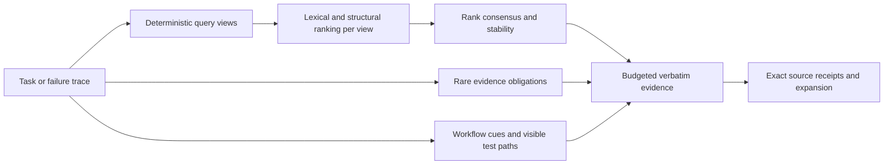

# RepoSqueeze V2

Robust, local repository context for Copilot and MCP coding agents. V2 is a separate Node package and VS Code extension, so the original [RepoSqueeze](https://github.com/2002-rokkam/reposqueeze) continues to work.

V2 introduces **perturbation-consensus retrieval (PCR)**. It ranks repository evidence from up to six deterministic views of the same request, rewards evidence that survives wording removal, tracks rare query obligations, and treats failure traces as a workflow signal rather than ordinary semantic search. Version 2.1 adds a persistent two-stage index for repositories with tens of thousands of files. Source excerpts remain verbatim and line-cited.

This is a research implementation with reproducible evidence. “New” means the technique is specified and tested here. It does not claim patent novelty, universal 100% accuracy, or guaranteed Copilot credit savings.

## Install alongside V1

Requires Node.js 20.19 or newer.

```sh
npm install -g git+https://github.com/2002-rokkam/reposqueeze-v2.git
reposqueeze-v2 --help
```

The commands do not collide:

| Package | CLI | VS Code extension ID | Native tools |
| --- | --- | --- | --- |
| V1 `reposqueeze` | `reposqueeze` | `2002-rokkam.reposqueeze` | `reposqueeze_context`, `reposqueeze_expand` |
| V2 `reposqueeze-v2` | `reposqueeze-v2` | `2002-rokkam.reposqueeze-v2` | `reposqueeze_v2_context`, `reposqueeze_v2_expand` |

V2 settings use `reposqueezeV2.*`, its instruction file is `.github/instructions/reposqueeze-v2.instructions.md`, and optional embeddings are stored in `.reposqueeze-v2/`. V1 remains independent.

## Use

```sh
reposqueeze-v2 context --root /path/to/repo --query "failure or task" --budget 3000
reposqueeze-v2 expand --root /path/to/repo --path src/file.ts --start 1 --end 120
reposqueeze-v2 map --root /path/to/repo --budget 1500
reposqueeze-v2 init --root /path/to/repo
```

For local semantic fusion:

```sh
ollama pull all-minilm
reposqueeze-v2 context --root /path/to/repo --query "task" --semantic-model all-minilm
```

PCR itself makes no model or network calls. Embeddings are optional, explicitly sent only to Ollama at `127.0.0.1:11434`, and fused as another ranking signal.

### MCP

Merge this into your client's MCP configuration:

```json
{
  "mcpServers": {
    "reposqueeze-v2": {
      "type": "stdio",
      "command": "reposqueeze-v2",
      "args": ["mcp", "--root", "/absolute/path/to/repository"],
      "tools": ["*"]
    }
  }
}
```

The server exposes `reposqueeze_v2_context`, `reposqueeze_v2_expand`, `reposqueeze_v2_map`, `reposqueeze_v2_compact`, and `reposqueeze_v2_json`.

### VS Code

```sh
npm ci
npm run package
code --install-extension releases/reposqueeze-v2-2.1.0.vsix
```

Enable **RepoSqueeze V2 Context** and **RepoSqueeze V2 Expand** in Copilot's tool picker. Use `#reposqueezeV2` in a prompt to request the context tool. Run **RepoSqueeze V2: Install Copilot Instructions** once per repository if you want retrieval-first guidance.

## V2 technique



PCR uses the original request, diagnostic lines, identifier-heavy text, and three deterministic leave-one-bucket-out views. Reciprocal rank fusion rewards chunks and files that appear across views. Rare terms become evidence obligations used during packing. For failure traces, visible test files are treated as starting signals and same-stem implementation files are favored; tests remain available when the user asks for tests.

The reported stability value measures agreement between deterministic retrieval views. It is not a calibrated probability that an answer is correct. Missing obligations are surfaced in JSON statistics so callers can expand or use ordinary search.

## Repositories with 50,000 files

Repositories with more than 5,000 eligible files automatically use the large-repository cascade:

1. Enumerate up to 100,000 eligible files while respecting Git and RepoSqueeze exclusions.
2. Reuse a persistent file sketch containing hashes, language, line/token counts and compact term fingerprints. It stores no source text.
3. Score the complete file inventory against the query.
4. Re-read and parse only the strongest 600–1,800 candidates, depending on repository size and matches.
5. Run PCR, evidence obligations and token packing over those exact candidate chunks.

The cache is `.reposqueeze-v2/file-sketch-v1.json.gz`. Changed files are refreshed by size and modification time, and selected evidence is always re-read before output. Set `REPOSQUEEZE_REFRESH_INDEX=1` for one run after a tool performs timestamp-preserving edits. `REPOSQUEEZE_MAX_CANDIDATES=100..5000` can trade latency and memory for recall.

Safety limits are 100,000 eligible files, 2 GiB of indexed text, 2 MiB per file and directory depth 60. Exceeding one produces an explicit incomplete-index warning.

## Evaluation

V2 has three evaluation layers:

1. **Development stress suite:** 40 existing questions across eight repositories, each tested as original, 20% word dropout, telegraphic wording, and reordered wording. This was used before the external freeze.
2. **Independent 80:20 evaluation:** the official Agent Retrieval Bench `trace2code` release, split deterministically at the sample level into 80 development and 21 held-out samples. Each sample is tested in four query forms at equal ranks and a 4,000-token packing budget.
3. **Integration and invariants:** source fidelity, budgets, cache refresh, 11 parsers, MCP protocol, VS Code extension host, npm package installation, and cross-platform CI.
4. **Scale evaluation:** a deterministic 50,000-file TypeScript repository with at least 1.2 million lines, 100 query/gold pairs and 20 distractors per task, frozen 80:20.

Read [V2 evaluation](docs/V2_EVALUATION.md) for results, confidence limits, failures and raw report links. The external benchmark's repositories are not included in this package. Its archive SHA-256 and evaluator fingerprint are frozen in the reports.

Read [scale evaluation](docs/SCALE_EVALUATION.md) for cold-index, warm-query, memory and held-out results.

## Boundaries

- PCR can preserve a consistently wrong match. Agreement is useful for robustness, not truth.
- Static names and file stems do not resolve dynamic imports, reflection, runtime dispatch, generated code or cross-repository behavior.
- Query obligations come from corpus frequency. A rare irrelevant log token can become an obligation; packaging still uses ranking and budget checks.
- Trace-aware source preference is task-specific. It is disabled for explicit test requests but may still rank the wrong implementation counterpart.
- `o200k_base` is a local text count. Provider system prompts, tool schemas, cache writes, reasoning, later reads and retries remain outside the pack budget.
- Secret and ignore filters reduce accidental inclusion but are not a complete secret scanner.
- Large-repository prefiltering can miss a relevant file that shares no query, path or indexed term signal. Files with more than 8,192 unique normalized terms use a deterministic term sample. Use explicit paths, expansion, ordinary search, or a larger candidate limit when evidence is weak.

See [research and gap analysis](docs/V2_RESEARCH.md), [architecture](docs/ARCHITECTURE.md), and [third-party notices](THIRD_PARTY_NOTICES.md).

## Reproduce

```sh
npm ci
npm run check
npm test
npm run test:editor
npm run package

# External benchmark downloaded separately; see docs/V2_EVALUATION.md
ARB_TRACE_ROOT=/path/to/extracted/arb-trace node --import tsx scripts/benchmark-v2-arb.ts development
ARB_TRACE_ROOT=/path/to/extracted/arb-trace node --import tsx scripts/benchmark-v2-arb.ts test

# Generates /private/tmp/reposqueeze-scale-50000 on first run.
npm run bench:scale:development
npm run bench:scale:test
```

The held-out command refuses to run if retrieval or evaluator files differ from the frozen development fingerprint. The published blind ARB report is tied to V2.0 commit `190ef6d934af2cc21e3f70caf1431fb1e9e079e4`; use that commit for an exact reproduction. V2.1 keeps PCR ranking unchanged but has a separate frozen scale evaluation because repository enumeration and context reporting changed.
