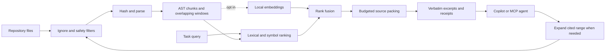

# How RepoSqueeze works

## Meaningful memory

The source of truth is the current repository. Tree-sitter extracts structural units and identifiers; overlapping windows provide coverage when definitions are too large or the language is unsupported. An in-process cache reuses parsed chunks by content hash. Every snapshot enumerates and hashes current files, so edits and deletion are observed without trusting stale timestamps.

Optional embeddings encode each eligible source chunk locally. Cache entries are keyed by source content and the Ollama model digest. Query vectors are computed afresh. Source changes invalidate affected entries; model changes invalidate the model namespace. Vectors supply semantic similarity, while exact source is re-read for output. This avoids relying on a generated prose summary that may have silently dropped a condition.

This is retrieval memory, not an autonomous knowledge graph with verified facts. A vector may retrieve the wrong meaning; a symbol may refer to several definitions. The actual held-out misses are retained in the evaluation report.

## Evidence budget packing

1. BM25 scores query terms against chunks. Identifier and path matches add a bounded structural signal.
2. A capped, one-hop boost uses identifier-reference overlap. These edges do not resolve imports, types, dynamic dispatch or execution order.
3. Optional semantic retrieval fuses lexical and embedding rankings using reciprocal ranks. Scores are ordering signals, not calibrated probabilities.
4. Packing rewards query coverage and file diversity and avoids heavily overlapping excerpts. If a whole chunk does not fit, progressively smaller contiguous windows can fit around relevant lines.
5. The final serialized text is counted, including labels, citations and omission instructions. It must stay within the requested budget.
6. Receipts hash the exact source range actually returned. A caller may explicitly mark a full chunk as retained; changed content is sent again. After conversation compaction or session changes, callers must discard old retained receipts.

This combination is an engineering design, not an established novel research contribution. In this evaluation, removing the reference boost did not change complete-evidence rates. We therefore make no demonstrated improvement claim for that component.

## Integration boundary

The CLI, MCP tools and VS Code tools call the same engine. All repository tools are read-only. The `init` command and VS Code setup command explicitly write one new instructions file, never overwrite it. MCP exposes context, expansion, map, log compaction and JSON conversion. The VS Code extension exposes context and expansion as native language-model tools plus three commands.

The extension cannot force Copilot to replace its own reads or change hidden prompts. Instructions encourage a concise answer before generation. They do not impose a provider output limit or reduce already-generated tokens. A task requiring many expansion calls can be more expensive than one direct read.

## Operational boundaries

No hosted API key is required for indexing. Default retrieval makes no network requests. Opt-in embedding requests are restricted to the fixed localhost Ollama endpoint. A model used by your coding agent still receives the excerpts returned by its tools.

File selection uses Git's tracked/untracked listing where possible, with a filesystem fallback and ignore processing. Paths are checked against the root; symlinks are excluded. Secret heuristics are incomplete by design, and source comments are labelled untrusted data. No prompt-injection classifier is claimed.

Scans have explicit file/size limits; partial indexes report warnings. Embeddings are capped separately to control latency. Invalid input budgets and ranges fail early. Expansion respects the same source filters. JSON conversion verifies decode equality and declines unsafe numbers; log truncation explicitly reports loss.

For very large repositories, use a narrower root. This release does not offer a daemon, database-backed cross-repository index, editor incremental file watcher, resolved call graph, remote embedding fallback, or automatic billing dashboard integration.
