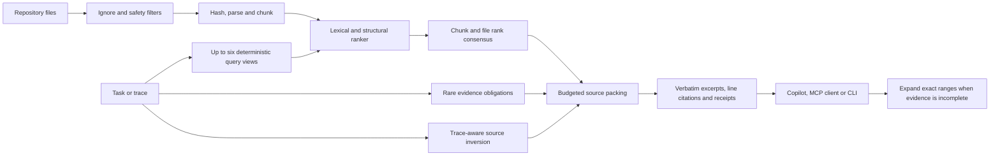

# RepoSqueeze V2 architecture

## Index and source fidelity

The current repository is the source of truth. Tree-sitter extracts structural units and identifiers for supported languages; overlapping line windows provide coverage for large definitions, unsupported files and parse failures. Source is cached only by its content hash. Every snapshot enumerates and hashes current files, so edits and deletion invalidate the affected entries.

The returned evidence is copied from current source rather than rewritten as a prose summary. Each range has a path, one-based lines and a content receipt. Expansion re-reads the current file and applies the same path, secret, size and symlink filters.

## Perturbation-consensus retrieval

PCR constructs up to six deterministic views: the complete request, diagnostic lines, identifier-heavy text and three leave-one-term-bucket-out views. Each view passes through the same BM25-style lexical ranker with bounded identifier, path and reference signals. Reciprocal ranks are accumulated at both chunk and file level. A stability value records how often a chunk remains near the top across views.

Rare query terms that occur in the corpus become evidence obligations. Packing favors coverage but reports obligations it cannot include. For failure traces, visible test paths guide navigation and same-stem implementation files receive a bounded boost. Test chunks receive a penalty unless the request explicitly concerns tests.

Optional local embeddings are an additional rank signal after PCR. They are requested only from Ollama on `127.0.0.1:11434`; cached vectors live under `.reposqueeze-v2/` and are keyed by content and model identity. PCR itself requires no model or network call.

## Budget and recovery

Packing removes heavily overlapping ranges, rewards query coverage and file diversity, and counts the final serialized text including headings and omission instructions. If a whole chunk does not fit, smaller contiguous windows are considered. The configured `o200k_base` count limits only tool output; it does not include provider prompts, tool schemas, reasoning, retries or later reads.

Consensus can agree on the wrong code. Stability is therefore a retrieval diagnostic rather than calibrated confidence. Missing obligations or weak evidence tell the caller to expand exact ranges or use ordinary repository search.

## Integrations and writes

The CLI, stdio MCP server and VS Code native tools share the same engine. Repository search, map and expansion calls are read-only. `reposqueeze-v2 init` and the VS Code setup command can create `.github/instructions/reposqueeze-v2.instructions.md`; they refuse to overwrite an existing file.

V2 uses separate command IDs, settings, cache paths and MCP tool names from V1. Both packages can be installed at once.

## Large-repository cascade

Parsing every definition in a 50,000-file repository for every question is wasteful. Above 5,000 eligible files, RepoSqueeze builds a compressed file-sketch index under `.reposqueeze-v2/`. Each entry contains the path, content hash, size, modification time, language, line count, exact local token count and sorted hashes of normalized terms. Source text is not stored in the index.

The query is evaluated against every sketch using corpus rarity plus path and foundation-file signals. The strongest bounded candidate set is re-read from disk, checked again for secrets and symlinks, parsed with Tree-sitter and then passed to PCR. This separates cheap repository-wide filtering from expensive structural ranking.

The approach follows the established large-code-search principle of a persistent cheap index followed by exact verification. [Zoekt](https://github.com/sourcegraph/zoekt/blob/main/doc/design.md) and [GitHub Code Search](https://github.blog/engineering/architecture-optimization/the-technology-behind-githubs-new-code-search/) use positional n-gram indexes at a much larger scale; RepoSqueeze uses smaller per-file term sketches because its output is a limited context pack rather than a general regular-expression search service.

Modification time and size avoid rereading unchanged files. Exact evidence is always re-read. Timestamp-preserving external edits require `REPOSQUEEZE_REFRESH_INDEX=1`; this boundary is reported in every cascade-mode context pack.
